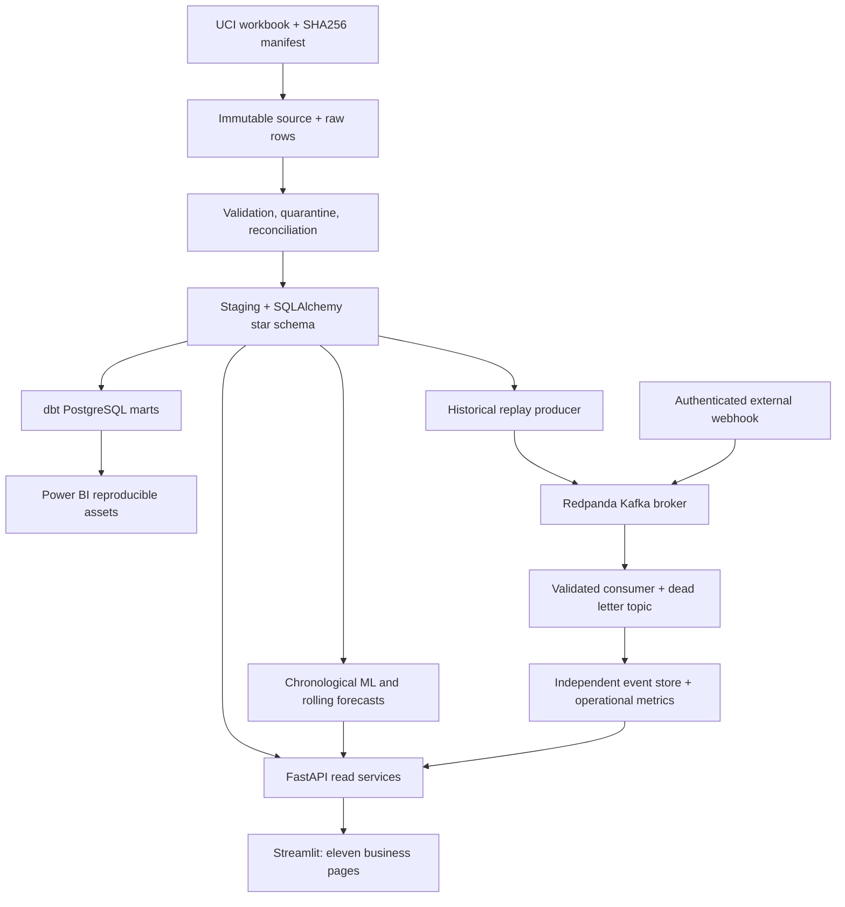

# UK Commerce 360 architecture

Independent portfolio application using UCI Online Retail II (2009–2011), not a
live retailer. Revenue is in GBP; profit, attribution and campaign uplift are not
observed in this source.

Primary deployment: Compose PostgreSQL, Redpanda, initialization job, FastAPI,
Streamlit and consumer. MLflow is local experiment tracking. Local SQLite mode
runs batch analytics/API/UI without pretending broker or PostgreSQL is available.
Raw data never goes to Git. Customer HMAC keys are persistent local secrets.

Batch processing is chunked and restartable, keyed by source checksum/sheet/row.
Each row carries validation disposition. Fingerprint deduplication spans chunks.
Reprocessing a checksum is idempotent. Decimal amounts reconcile sales and returns;
valid unidentified sales remain in revenue but are excluded from customer models.
Events have deterministic IDs, separate historical event, replay and ingestion
times, and do not mutate historical fact tables.
