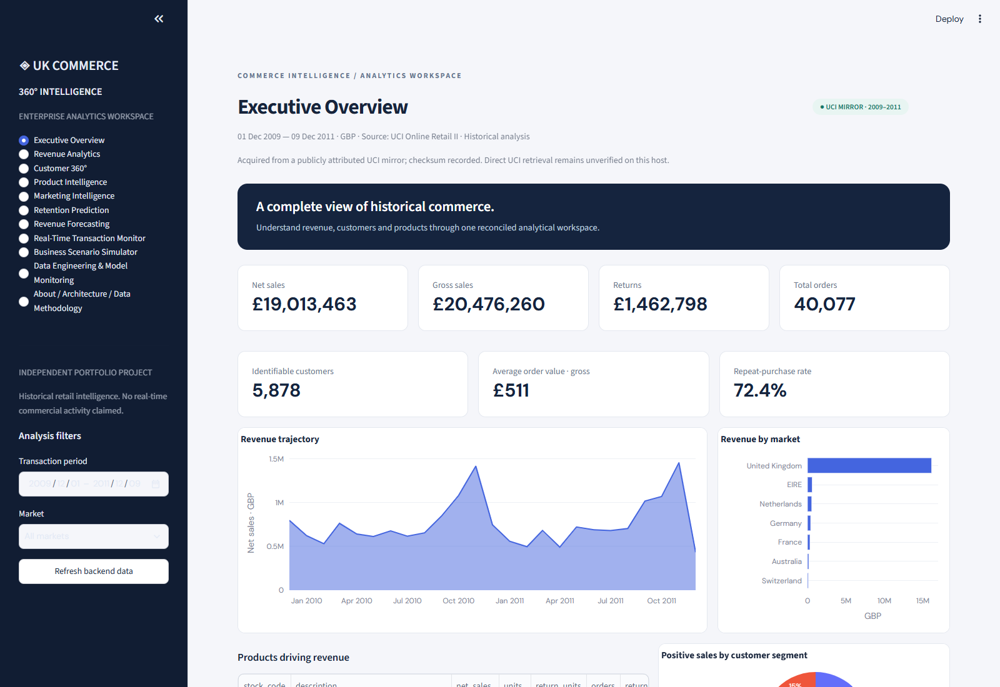
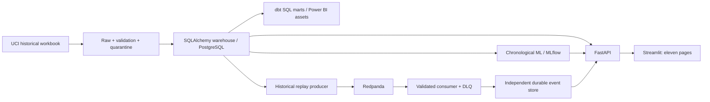

# UK Commerce 360° Intelligence

An independent portfolio platform for historical UK retail analysis, customer insight,
predictive evaluation and data engineering. Built with coding-agent assistance.
**No employment, real customers, production deployment or commercial uplift is claimed.**



The business scenario is a hypothetical retailer with fragmented reporting and weak
visibility of repeat purchasing, products and returns. The platform turns auditable
transaction records into defined KPIs, customer cohorts, product intelligence and
transparent decision-support scenarios.

**Execution evidence:** [delivery report](docs/DELIVERY_REPORT.md),
[persistent progress](PROGRESS.md), [limitations/runbook](docs/deployment/RUNBOOK.md).
Implementation and actual service verification are reported separately.

## Run locally on Windows

The current workspace already contains the processed historical dataset and trained
artifacts. Its active backend is native PostgreSQL on port 5433; the start/stop scripts
manage this project's database alongside the application. Start with:

```powershell
powershell -NoProfile -ExecutionPolicy Bypass -File scripts/start.ps1
```

* Dashboard: http://127.0.0.1:8501
* API documentation: http://127.0.0.1:8000/docs
* API readiness: http://127.0.0.1:8000/ready

For a fresh checkout, setup installs uv/Python **inside the workspace**, locks
dependencies, creates local secrets, migrates the database, ingests data and trains:

```powershell
powershell -ExecutionPolicy Bypass -File scripts/setup.ps1
```

This host cannot resolve UCI directly. A separately attributed mirror of the same
workbook is supported explicitly:

```powershell
powershell -ExecutionPolicy Bypass -File scripts/setup.ps1 -UseMirror
```

The mirror SHA256 is checked against its published metadata and recorded in a manifest;
the application prominently labels mirror provenance. Direct upstream byte comparison
remains pending. The nine-row synthetic fixture is **only for tests**, not the normal app.

```powershell
powershell -ExecutionPolicy Bypass -File scripts/verify.ps1
powershell -ExecutionPolicy Bypass -File scripts/stop.ps1
```

Cross-platform Python workflow: install uv, `uv sync --frozen --extra dev --extra warehouse`,
`uv run commerce bootstrap`, `uv run alembic upgrade head`, `uv run commerce pipeline`,
`uv run commerce train`. In separate terminals run `uv run uvicorn commerce.api:app`
and `uv run streamlit run app/dashboard.py`. Store secrets in an ignored .env.

## Architecture and stack



Python 3.12 · Pandas · NumPy · SciPy · SQLAlchemy · Alembic · PostgreSQL · dbt Core
· scikit-learn · statsmodels · MLflow · FastAPI/Pydantic · Streamlit/Plotly
· confluent-kafka/Redpanda · Pytest · Ruff · uv · Docker Compose · GitHub Actions.

SQLite is an explicitly supported local analytics mode. It does not demonstrate a
running broker or replace actual PostgreSQL checks. The full stack configuration is:

```powershell
powershell -ExecutionPolicy Bypass -File scripts/start.ps1 -Docker
```

Docker Desktop installation alone is insufficient: its engine and Windows prerequisites
must work. Consult the delivery report for actual Compose/broker verification. No Azure
resources or paid services have been created. [Azure design](docs/deployment/AZURE.md)
and a limited Bicep example are supplied, not a completed cloud deployment.

## Data, quality and warehouse

Source: Chen, D. (2012), **Online Retail II**, [UCI repository](https://archive.ics.uci.edu/dataset/502/online+retail+ii),
[DOI 10.24432/C5CG6D](https://doi.org/10.24432/C5CG6D),
[CC BY 4.0](https://creativecommons.org/licenses/by/4.0/). Transactions cover 2009–2011.
The dataset is historical, not current live sales. Raw files, source customer IDs,
databases, local tools and secrets are excluded from Git.

Every imported row has an accepted, quarantined or duplicate disposition. Invalid
prices/quantities/dates are preserved for review. Missing customer IDs remain in
valid revenue but are excluded from customer models. Cancellations/negative quantities
form separate return facts. Money uses Decimal half-up rounding. Customer output keys
are HMAC pseudonyms. Operational ingestion timestamps are distinct from source dates.

The star schema contains customer/product/date/country dimensions, sales and returns
facts, customer order activity, model marts and operational logs. dbt creates daily,
monthly, RFM, cohort, retention and product marts. SQL examples demonstrate windows,
CTEs, cumulative revenue contribution, geographic ranking, associations and YoY.

See [dictionary](docs/data-dictionary/DATA_DICTIONARY.md),
[quality methodology](docs/data-quality/METHODOLOGY.md),
[SQL](sql/analytics) and [architecture](ARCHITECTURE.md).

## Application modules

1. Executive Overview — gross/returns/net, orders, AOV, repeat rate, trends and markets.
2. Revenue Analytics — date/country filtering, trends and filtered report exports.
3. Customer 360° — pseudonymous timeline, RFM, value and cohort retention.
4. Product Intelligence — revenue/units/returns and association rules.
5. Marketing Intelligence — audience priorities and explicitly assumed scenarios.
6. Retention Prediction — model comparison, calibration and historical propensity scores.
7. Revenue Forecasting — baseline comparison, held-out results and uncertainty bands.
8. Real-Time Transaction Monitor — genuine event-store counts and worker state when running.
9. Business Scenario Simulator — response/incrementality/contribution sensitivity.
10. Data Engineering & Model Monitoring — dispositions, run history and model status.
11. About / Architecture / Methodology — source, assumptions and limits.

Every page reads backend computations. There are no independently simulated live counters.
Scenario spending and contribution are assumptions because no observed campaign or cost
data exists. Profit, attribution and causal uplift are not inferred.

## Machine learning and statistical evidence

Repurchase prediction uses six chronological snapshots, 180-day observation windows
and a 30-day future target. Label horizons finish before validation/test cutoffs.
Compare prior baseline, logistic regression, random forest and gradient boosting using
precision/recall/F1, average precision, ROC-AUC, Brier score and calibration. Preserve
the frozen evaluated model separately from the refitted historical serving artifact.

Daily net-sales forecasts compare naive, weekly seasonal-naive, Holt-Winters and Ridge
lag regression at rolling development origins, then an untouched final 28-day test.
MAE, RMSE and WAPE are measured. Residual uncertainty bands are approximate, with no
coverage guarantee. A seeded invoice bootstrap describes AOV uncertainty; basket rules
have temporal holdout summaries. None establish causal business impact.

Actual figures and model caveats are in the [delivery report](docs/DELIVERY_REPORT.md)
and [model cards](docs/machine-learning/MODEL_CARDS.md). Full artifacts stay local;
aggregate evaluation evidence is copied under docs/machine-learning/results.

## API, streaming and operations

The API provides all required `/api/v1` KPI, sales, customer, product, forecast,
prediction, scenario, stream and monitoring routes plus versioned OpenAPI. Read pages
are intended for loopback development. Write operations require the locally generated
Bearer token, with a per-process write rate limit. Public deployment needs additional
identity, TLS, distributed controls and restricted database/broker access.

Historical replay publishes actual broker messages with event_time/replay_time;
the consumer validates, commits durable event records before offsets and routes invalid
payloads to a DLQ. Deterministic IDs protect retries and resets. Replay never inserts
into historical facts. The monitor's counters come from stored events and worker
heartbeats; unavailable lag remains unknown. An authenticated external webhook adapter
supports authorised new events without claiming an actual retailer integration.

Power BI [M/DAX/theme/model assets](dashboards/powerbi) are supplied with exact assembly
instructions. No PBIX or validated PBIP is fabricated. The Streamlit app works independently.

## Repository map

```text
src/commerce/        config, warehouse, ingestion, analytics, ML, API, streaming
app/                eleven-page Streamlit application
database/migrations Alembic schema management
dbt/                PostgreSQL marts and data tests
sql/                executable analytics, validation and EXPLAIN examples
data/fixtures/      deliberately small synthetic test source
scripts/            Windows automation, acquisition, verification and evidence
dashboards/powerbi/ Power Query, DAX, theme, model and assembly guide
docs/               BA, methodology, models, deployment, screenshots and portfolio
infra/              limited Azure Bicep example
tests/              unit, API, SQL, UI and genuine-service tests
.github/workflows/  locked environment, lint, tests, audit and service CI
```

## Limitations and next steps

The historical source has missing IDs, unmatched returns, variable descriptions and an
incomplete final trading day. Exact-line deduplication may exclude genuinely repeated
identical lines. Catalogue categories are heuristic. Model thresholds and calibration
require business review; historical forecasts are not valid present-day predictions.
Service-level verification, Power BI authoring and container/cloud deployment must be
qualified using the delivery report. No 24/7 availability, causal result or deployment
security certification is claimed.

Future work should prioritise verified broker integration, restore exercises, improved
catalogue governance, clustered uncertainty estimates, threshold/cost evaluation and
authorised experiments with genuine campaign data.

[Business analysis](docs/business-analysis/BUSINESS_ANALYSIS.md) ·
[CV/LinkedIn copy](docs/portfolio/PROFILES_AND_CV.md) ·
[Interview/demo script](docs/portfolio/INTERVIEW_AND_DEMO.md).

Code: [MIT](LICENSE). Dataset and dependencies retain their own licences.
