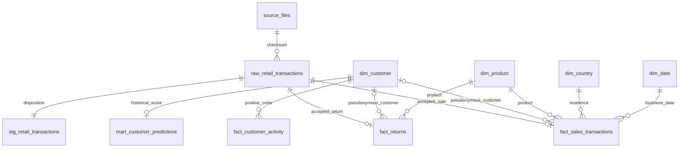

# Relational design and operating modes

The staging layer is operational and auditable. Sales/return facts reference source
rows and dimensions, with primary/foreign keys and bounded decimal amounts. Customer
NULL is permitted. Invoice/time/date/customer indexes support typical filtering. The
event store has independent deterministic IDs and broker topic/partition/offset keys.
There is no relationship that adds replay events to historical sales totals.

PostgreSQL is the primary relational platform. Alembic applies versioned metadata;
dbt builds the analytics schema. SQLite uses the same SQLAlchemy table definitions for
local batch/UI execution, enables foreign keys and WAL, and does not execute PostgreSQL
dbt SQL. Actual PostgreSQL testing uses the genuine server, not a SQLite compatibility
claim. SQL files explicitly marked postgres require PostgreSQL.

On this Windows host a workspace PostgreSQL runtime can be started without a Windows
service using `python scripts/postgres_local.py start`; it listens on 127.0.0.1:5433.
It requires the already acquired server binaries. `verify`, `transfer` and `dbt` actions
test the real database, preserve lineage while copying the validated warehouse, and
run dbt. `stop` shuts down only this project cluster. It uses SCRAM and .env secrets.
Docker PostgreSQL uses port 5432 and its own volume; these are separate databases.

The transfer operation is a migration of already validated records, not a claim that
Excel was reread by PostgreSQL. A separate real PostgreSQL ingestion test validates
the loader's target-database path. All table counts must match before transfer evidence
is written. An older-than-overlap dbt backfill needs full refresh. Review actual EXPLAIN
output under docs evidence before proposing performance improvements.
