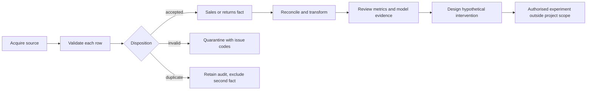

# Business analysis pack

## Business case and charter

UK Commerce 360 is an independent portfolio exercise for a hypothetical UK online
giftware retailer. It integrates fragmented sales, customer and operational analysis
in one reproducible platform. There is no actual employer, client, stakeholder
interview, production adoption or financial improvement claimed.

Sponsor persona: hypothetical Head of Commerce. Product owner persona: hypothetical
Commercial Analytics Manager. Delivery owner: project author using coding-agent
assistance. Decision rights: owner approves paid resources, external publishing and
restricted source access. Project success is demonstrated by repeatable calculations,
auditable quality decisions, measured model evaluation and functioning interfaces.

Problem: inconsistent reporting and disconnected tools make revenue reconciliation,
repeat-purchase analysis and targeting decisions difficult. Objectives: establish a
documented revenue definition; build customer/product intelligence; evaluate future
purchase signals; demonstrate actual event processing; support transparent scenarios.

In scope: historical UCI data, quality audit, warehouse, SQL/dbt, API, dashboard,
predictive evaluation, historical replay, reporting assets and evidence documentation.
Out of scope: actual advertising attribution, causal retention uplift, profit from
observed costs, customer contact, checkout, payment data, paid hosting and production SLA.

## Hypothetical personas and user needs

| Persona | Decision | Need | Evidence |
|---|---|---|---|
| Managing Director | Review trading | Reconciled net sales and exceptions | Executive page, KPI API |
| Commercial Analyst | Diagnose sales mix | Product/market/date filtering | Revenue and product pages |
| CRM Manager | Prioritise an experiment | Segments, recent behaviour, explicit assumptions | Marketing and scenarios |
| Customer Insights Analyst | Understand retention | Cohorts and purchasing timeline | Customer 360 |
| Data Engineer | Recover failed ingestion | Lineage, quarantine, idempotent retry | Raw/staging and run logs |
| Data Scientist | Assess model usefulness | Temporal evaluation and calibrated probabilities | Model artifacts and page |
| Governance Reviewer | Review data handling | Pseudonymization and source restrictions | Governance/runbook |

## Requirements and traceability

| ID | Requirement / user story | Acceptance criterion | Implementation / validation |
|---|---|---|---|
| BR01 | As an executive I need a common sales definition | Net = gross minus returns under identical filters | analytics.kpis; KPI fixture test |
| BR02 | As an analyst I need auditable data | Every source line has one disposition; no silent deletion | ingest, reconciliation test |
| BR03 | As a CRM user I need customer segments | Identified positive-purchase customers receive reproducible RFM scores | analytics.rfm; segmentation test |
| BR04 | As a product analyst I need return visibility | Negative/cancelled lines reduce sales once | fact_returns; Decimal test |
| BR05 | As an insights user I need cohorts | Period-zero retention = 100%; future cells blank | retention test and dbt bounds |
| BR06 | As a planner I need forecast comparisons | Baselines and final chronological test reported | ml.train_forecast artifact |
| BR07 | As a scientist I need repurchase evaluation | Labels follow cutoff; observation window excludes future data | features_at and leakage test |
| BR08 | As an engineer I need actual replay | Acknowledged broker messages reach durable event storage | services test; requires broker |
| BR09 | As an executive I need trustworthy totals | Replaying source events never changes historical fact totals | event isolation test |
| BR10 | As a marketer I need scenario sensitivity | Every output states assumptions and hypothetical status | scenario/API tests |
| BR11 | As a user I need exports | Filtered CSV and management JSON match the selected backend data | API export tests |
| BR12 | As an operator I need recovery | Retry a source checksum without adding duplicate facts | chunked retry test |
| NFR01 | Protect customer identities in outputs | No source customer ID in curated tables/API | pseudonymization tests |
| NFR02 | Authenticate mutations | Missing/incorrect token receives 401 | API auth tests |
| NFR03 | Reproduce local installation | Locked dependency environment and automated scripts exist | uv.lock; setup/start/verify |
| NFR04 | Explain limitations | Historical labels on all application pages | dashboard and methodology |
| NFR05 | Use appropriate numeric precision | Line revenue rounds Decimal half-up to 2dp | cleaning unit test |
| NFR06 | Accessibility | Labeled controls, table alternatives and readable colours | browser inspection required |

## Business processes

## KPI dictionary

| KPI | Definition | Limit |
|---|---|---|
| Gross sales | Sum accepted positive-purchase line amounts, GBP | Includes valid unidentified buyers and non-merchandise charges |
| Returns | Negative of accepted cancellation/return amounts | Does not establish physical receipt or original-order linkage |
| Net sales | Gross sales − returns | No observed cost/profit deduction |
| Orders | Distinct positive-purchase invoices | Return-only invoices excluded |
| Identifiable customers | Distinct non-null pseudonymous customers in positive purchases | Missing IDs excluded |
| Average order value | Gross sales / positive-purchase orders | Uses invoice grain, not line grain |
| Repeat-purchase rate | Identified customers with >1 positive invoice / identified customers | Within selected observation period |
| Cohort retention | Identified buyers active in month n / first-purchase cohort size | First purchase is bounded by available source/selection |
| RFM value | Positive-purchase spend; recency and distinct-invoice frequency | Not lifetime profit or causal loyalty |
| Scenario contribution | Audience × response × incrementality × AOV × assumed contribution rate − budget | All campaign parameters are hypothetical |

## Risk register, assumptions and constraints

| Risk | Likelihood / impact | Response / owner |
|---|---|---|
| Source ends in 2011 | Certain / high | Historical labels; no current-sales claims / analytics owner |
| Missing customer IDs | High / high | Retain revenue; exclude from customer models / data engineer |
| Incomplete final trading day | High / medium | Document boundary bias and right-censoring / data scientist |
| Returns not matched to original purchase | High / medium | Period-based reporting and explicit caveat / analyst |
| Temporal leakage | Medium / high | Cutoff-based features, horizon embargo, tests / data scientist |
| OS prevents containers | Medium / high | Honest local mode; service verification blocked / operator |
| Source DNS failure | Observed / high | Explicit mirror provenance; direct upstream check still required / operator |
| Secret/customer exposure | Medium / high | Ignore raw/.env; HMAC; least privilege / owner |
| Single-node broker failure | Medium / high | Development-only topology; no HA claim / operator |

Assume sterling pricing as described by UCI. Country indicates customer residence,
not shipping address or currency. Product code pattern is only a heuristic category;
it must not be treated as a verified catalogue taxonomy. No marketing spend or costs
are inferred. Available hardware, administrator privileges and network access constrain
service verification. No stakeholder has actually approved these fictional requirements.

## Governance and cost-benefit framework

Raw data and source customer IDs remain local and Git-ignored. Curated customer keys
are keyed HMAC pseudonyms, not anonymisation. Restrict raw warehouse access; maintain
the HMAC key securely for stable identifiers. A key rotation requires a full curated
rebuild and invalidates dependent customer artifacts. Source licence attribution is
preserved. This is a portfolio governance design, not a legal compliance certification.

Estimate operating cost from measured compute/storage/network consumption and approved
prices. Estimate benefits using explicit assumptions about analyst time saved or an
authorised experiment's incremental contribution. Record base/downside/upside cases,
probability, confidence and evidence. Do not enter claimed savings before measurement.

## Management recommendation

First reconcile sales and review missing IDs/invalid prices. Use customer value and
recency to formulate testable targeting hypotheses. Treat propensity scores as decision
support subject to calibration and drift review; assess PR-AUC against prevalence and
forecast MAE against seasonal-naive before adoption. Investigate high-return products
before proposing interventions. Seek proper experimental and cost data before claiming
commercial ROI. Review the final delivery report for what was actually executed.
